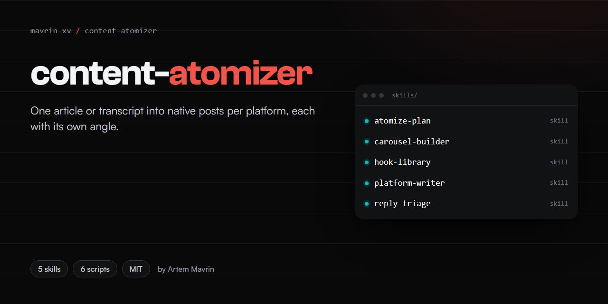
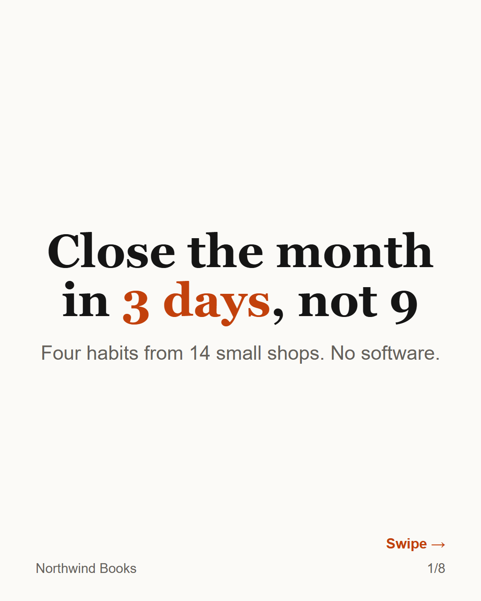
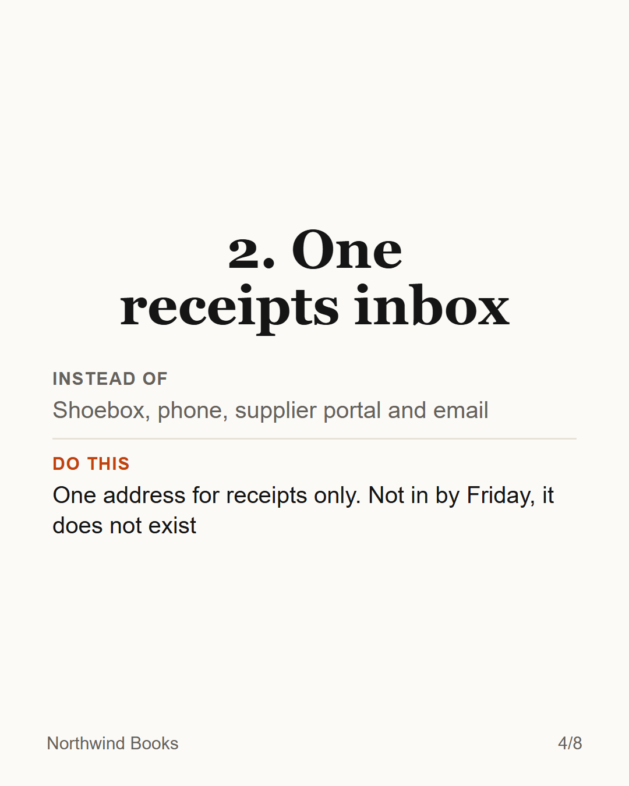

# content-atomizer

**Turn one article, transcript or talk into native posts per platform: an X thread, a Telegram or newsletter post, rendered carousels and a short video script, each with its own angle. For creators, consultants and small teams who write one good piece a week and want it to reach every feed they use.**

Most repurposing pastes the same paragraph into five apps, invents a number on the way, and puts a link where the platform buries it. This pack plans from what the source actually says, writes each piece for its room, and checks limits, links, hooks and every number with a script.

  

```bash
git clone https://github.com/mavrin-xv/content-atomizer && cd content-atomizer
./install.sh            # or: ./install.sh --project  (this project only)
```

<!-- install-notes:start -->
Other ways in: as a Claude Code plugin, run `/plugin marketplace add mavrin-xv/content-atomizer` and then `/plugin install content-atomizer@content-atomizer`. For Codex or another agent that reads `SKILL.md`, copy the folders under `skills/` into its skills directory. On Windows, run `install.sh` from Git Bash or WSL and type `py -3` where these docs say `python3`.
<!-- install-notes:end -->

## What it solves

| Pain | What the pack does |
|---|---|
| Every platform gets the same text | `atomize-plan` pulls the ideas out of the source first, then gives each platform its own treatment and hook type, or skips it with a reason |
| Posts quietly grow numbers the source never had | Every atom carries an exact quote from the source, and `post_check.py` fails any digit in a post that is not in the source |
| Threads die because the link is in the first post | `post_check.py` fails a link in an X body, a clickable link promised on Instagram or TikTok, a spoken hook that lands after 3 seconds and posts over the limit |
| Carousels with a paragraph on slide 1 and no ask on the last | `carousel-builder` has five frameworks, a linter for slide rules, a renderer to PNG and PDF, and a visual QA loop with a blind read |
| You guess which hooks work | `hook-library` keeps your first lines with one metric each and ranks the frames you used three or more times by median result |
| The first hour of comments goes to "great post" | `reply-triage` ranks comments into six tiers, flags price and refund questions for a person, and checks the drafts |

## What's inside

| Skill | What it does | Say |
|---|---|---|
| [atomize-plan](skills/atomize-plan/SKILL.md) | Core insight, atoms with evidence, a treatment per platform, budget and freshness checks | "atomize this", "repurpose this article" |
| [platform-writer](skills/platform-writer/SKILL.md) | X thread, Telegram or newsletter post, Threads, LinkedIn, captions, short video scripts, checked and scored | "write the thread", "TikTok script from this" |
| [carousel-builder](skills/carousel-builder/SKILL.md) | Five frameworks, slides.json, lint, render to HTML, PNG or PDF, visual QA | "make a carousel", "LinkedIn document post" |
| [hook-library](skills/hook-library/SKILL.md) | A CSV of your hooks with nine types, slot patterns, scoring and ranking by results | "build a hook library", "score this hook" |
| [reply-triage](skills/reply-triage/SKILL.md) | Six-tier comment ranking, needs-a-person flags, draft checks | "help me reply to comments" |

Scripts (Python standard library, each with `--help`): `plan_check.py`, `post_check.py`, `carousel_lint.py`, `render_carousel.py`, `hook_bank.py`, `triage_replies.py`. PNG and PDF export uses Playwright if you have it.

## Quick start

1. Install, then open Claude Code in your project.
2. Paste your source and ask:
   ```
   > Here is our article on how 14 clients cut their month-end close from
     9 days to 3. Atomize it: a thread, a Telegram post, a carousel and a
     TikTok script. We do not post on LinkedIn.
   ```
3. You get a 3 to 5 line plan to approve, then `atoms/<slug>/pieces.md`, `slides.json` and the rendered slides. Every file is checked by its script before you see it.

Run the scripts on the invented example first, from the repo root:

```bash
python3 skills/atomize-plan/scripts/plan_check.py examples/northwind-books/plan.json
python3 skills/platform-writer/scripts/post_check.py examples/northwind-books/pieces.md --source examples/northwind-books/source.md
python3 skills/carousel-builder/scripts/render_carousel.py examples/northwind-books/slides.json -o /tmp/carousel.html --png /tmp/slides
python3 skills/hook-library/scripts/hook_bank.py score "14 bookkeeping clients used to close 9 days late. Now it takes 3."
```

Sample output:

```
PASS 6 atoms, each with evidence found in the source
PASS linkedin skipped: not an active account for this business
PASS platform-facts fresh until 2027-02-18

PASS x: thread: within 280 chars per post
PASS tiktok: video-script: hook lands in 3s with 7 words
PASS tiktok: video-script: about 29s spoken (73 words)
INFO highest phrase overlap between two pieces: 5%

8/10  14 bookkeeping clients used to close 9 days late. Now it takes 3.
  +2 has a number
  +1 length 13 words
  type: time-transformation
```

Two of the eight rendered slides:

 

The whole run for an invented bookkeeping firm (source, plan, four pieces, slides, hooks, comments and drafted replies) is in [examples/northwind-books/](examples/northwind-books/).

## How it works

```
 source.md (article / transcript / talk)
        |
   atomize-plan + plan_check.py ---------> plan.json (atoms with evidence,
        |                                   a treatment per platform)
        +--------------------+
        v                    v
   platform-writer      carousel-builder
   + post_check.py      + carousel_lint.py + render_carousel.py
        |                    |
   pieces.md            slides.json --> carousel.html, PNG, PDF
   (thread, Telegram,
    captions, video script)
        |
        v   you post
   comments.txt --> reply-triage + triage_replies.py --> replies.md
   results      --> hook-library + hook_bank.py      --> hooks.csv
                    (feeds the hook type for the next plan)
```

The model makes the judgement calls: what the point is, which idea fits which feed, every word. The scripts do the counting, so a 281-character post, a link in the wrong place or a number the source never had is caught every time. Longer walkthrough: [docs/how-it-works.md](docs/how-it-works.md). File formats: [docs/file-formats.md](docs/file-formats.md).

## Configure

| What | Where |
|---|---|
| Your accounts, voice and asks | `templates/brief.md`, filled once |
| Platform limits and link rules | the `LIMITS` and `NO_LINK` tables at the top of `post_check.py` |
| Ranking facts and their verify date | `skills/atomize-plan/references/platform-facts.md` (`last_verified`, `ttl_days`) |
| Carousel look | `render_carousel.py --theme paper --accent "#hex"` (themes: dark, light, editorial, paper), or `theme` and `accent` in slides.json |
| Video length | `post_check.py --max-seconds 45` |
| Hook metric per platform | your choice, one per platform; see `skills/hook-library/references/collecting.md` |

No API keys. Nothing in the pack calls a network service.

## Honest limits

- The scripts were run on the invented example and on broken copies of it. The pack has not been measured against real posting results; it does not promise reach.
- Ranking facts are dated hypotheses. The X weights come from the 2023 open-source release and may have changed. `plan_check.py` fails when the facts file passes its verify date, so someone has to re-check it.
- The source check catches digits, not spelled-out numbers, and not claims without numbers. The model and you still check those.
- Hook type guessing and comment tiers are keyword rules. They misread sarcasm, jokes and other languages; correct them by hand.
- Text and carousels only. Video scripts are written and timed, not produced. There is no scheduling, posting or analytics fetching.
- The carousel themes are deliberately plain. The linter cannot see a cramped slide; the visual QA loop is done by eye.

## Credits

- Four treatments, the fit table, the 2-3 platform budget, the five-dimension quality gate, reply tiers and the dated platform facts: inspired by `content-atomizer` in https://github.com/boringmarketer/boring-marketing-skills (MIT).
- Content pyramid and per-platform action items: inspired by `content-repurposing` in https://github.com/openclaudia/openclaudia-skills (MIT).
- No duplicate hook patterns across platforms and the zero-context fallback: inspired by `content-atomizer` in https://github.com/moizibnyousaf/marketing-cli (MIT).
- Atoms before writing and the analyze-only mode: inspired by https://github.com/agricidaniel/claude-repurpose (MIT).
- Thin sources get fewer pieces; atomize ideas, not paragraphs: inspired by `content-atomizer` in https://github.com/sanky369/vibe-building-skills (MIT).
- Intro, content and outro slides and slide data as JSON: inspired by https://github.com/FranciscoMoretti/carousel-generator (MIT). No code copied.
- Engagement weights: `projects/home/recap/README.md` in https://github.com/twitter/the-algorithm-ml (AGPL-3.0, numbers cited as facts, no code used).
- Repo and skill layout: modelled on https://github.com/anthropics/skills and https://github.com/obra/superpowers (MIT).

## Contributing

See [CONTRIBUTING.md](CONTRIBUTING.md). Agents working on the repo: [AGENTS.md](AGENTS.md).

<!-- author:start -->
## Author

Built and maintained by [Artem Mavrin](https://github.com/mavrin-xv). This repo is one of a set of agent skill packs for marketing and operations work. Each one installs on its own; the full list is in [agent-skill-packs](https://github.com/mavrin-xv/agent-skill-packs). If a pack saved you an afternoon, a star helps other people find it.
<!-- author:end -->

## License

MIT. See [LICENSE](LICENSE).
